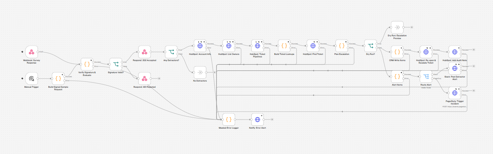

# n8n-hubspot-ticket-satisfaction-detractor-escalation

A real-time detractor escalation path for n8n. Your survey tool posts each **CSAT, NPS or NES** response to a signed webhook. The workflow checks the **HMAC-SHA256 signature**, keeps only detractors, and finds the related **HubSpot ticket**. It then **re-opens** the ticket if it was closed, raises its **priority** (never lowers it) and adds an **internal audit note** with the customer's feedback. Finally it alerts the ticket owner, account manager and executives with a **Slack Block Kit** card and, for critical cases, a **PagerDuty** incident.

| File | Purpose |
|---|---|
| `workflow.json` | Importable n8n workflow: webhook, signature check, config gate, HubSpot lookup/update/note nodes, planning Code node, dry-run switch, Slack + PagerDuty nodes, masked error branch |
| `escalation.js` | Config validation (`resolveConfig`), HMAC verification, payload parsing, detractor evaluation, re-open/priority logic, note HTML, Slack and PagerDuty payloads, `maskSecrets()` / `maskError()` |
| `env.example` | Every environment variable, with safe placeholders |
| `LICENSE` | MIT License |
| `DISCLAIMER.md` | Liability limitation and as-is terms |

---

## Contents

- [What the alert looks like](#what-the-alert-looks-like)
- [Safety and privacy](#safety-and-privacy)
- [Architecture](#architecture)
- [Webhook configuration](#webhook-configuration)
- [Security verification](#security-verification)
- [Detractor rules](#detractor-rules)
- [What happens to the ticket](#what-happens-to-the-ticket)
- [Routing and notifications](#routing-and-notifications)
- [HubSpot Private App and scopes](#hubspot-private-app-and-scopes)
- [Environment variables](#environment-variables)
- [Installation](#installation)
- [Using escalation.js outside n8n](#using-escalationjs-outside-n8n)
- [Editing the logic](#editing-the-logic)
- [Limitations](#limitations)

---

## What the alert looks like

```
🚨 Detractor escalation · CSAT 1/5
Customer: Example Customer Co. (c***@example.com)
Ticket:   #1000000001 Export fails after update · Support Pipeline
┌──────────────────────────────┬──────────────────────────────┐
│ Score       CSAT 1/5         │ Severity   🔴 Critical ("cancel") │
│ Ticket owner  @owner         │ Account manager  @am          │
│ Status  Closed → Waiting on us │ Priority  MEDIUM → HIGH      │
└──────────────────────────────┴──────────────────────────────┘
Feedback
> The issue came back after the ticket was closed and nobody followed up.
> We are considering whether to cancel.
[ Open ticket in HubSpot ]  [ View contact ]
cc @owner @am @exec-team
CSAT response `resp_0001` · submitted 2026-11-15T11:00:00Z · HubSpot ticket updated and note added
```

Every name, ID and value above is fictional. In dry-run mode the header starts with `[DRY RUN]` and nothing is posted.

---

## Safety and privacy

| Guardrail | Behaviour |
|---|---|
| **Signed requests only** | Every webhook request needs a valid HMAC-SHA256 signature over the exact raw body, with a timestamp inside a 5-minute window. Failures get `401` and stop there. See [Security verification](#security-verification). |
| **Dry run by default** | `DRY_RUN=true` verifies, evaluates, looks up and plans everything. Open **Plan Escalation** to see the ticket update, note, Slack card and PagerDuty event. Nothing is written to HubSpot and no alert is sent. Only an explicit `false` turns it off. |
| **Sandbox gate** | `SANDBOX_MODE=true` (default) stops the run unless `GET /account-info/v3/details` reports a `SANDBOX` or `DEVELOPER_TEST` portal. |
| **Bounded CRM changes** | Priority is only ever raised. Tickets closed more than `REOPEN_MAX_AGE_DAYS` ago are escalated and noted but not re-opened. Notes are not retried automatically, to avoid duplicates. |
| **Duplicates ignored** | A `response_id` seen within `DEDUPE_HOURS` (live runs) is skipped. PagerDuty events use a stable `dedup_key`. |
| **Secrets stay in `$env`** | The HubSpot token, webhook secrets, Slack URLs and PagerDuty routing key are read by the nodes at request time. Item data only carries presence flags and a channel count. |
| **PII-light** | Customer emails are masked (`c***@example.com`) before they enter item data, unless `SHOW_CUSTOMER_EMAIL=true`. Owner emails are used only to match Slack IDs and are stripped from the plan. Notes and PagerDuty events contain no emails. |
| **Masked errors** | Every node's error output goes to **Masked Error Logger**. `maskError()` runs `maskSecrets()`, which strips known secret values, `Bearer`/`Basic` headers, `pat-…` tokens, Slack webhook URLs, `xox…` tokens, `routing_key` values, `sha256=` signatures, token query parameters, email addresses and phone numbers. The result goes to `ALERT_WEBHOOK_URL` (optional). |
| **Retries & pacing** | HubSpot reads, the ticket update, Slack and PagerDuty retry 3× with backoff. Requests are paced (ticket search 250 ms, writes 200 ms, Slack 1.1 s). |
| **Placeholders** | Any value matching `YOUR_…` counts as "not set". |

---

## Architecture



```
Webhook: Survey Response (POST, raw body) ─┐
Manual Trigger → Build Signed Sample ──────┴─► Verify Signature & Evaluate   (resolveConfig, verifySignature, evaluateBody, dedupe)
                                                   │
                                            Signature Valid? ──false──► Respond: 401 Rejected
                                                   │true
                                            Respond: 202 Accepted
                                                   │
                                            Any Detractors? ──false──► No Detractors
                                                   │true
                         HubSpot: Account Info ─► List Owners ─► Ticket Pipelines
                                                   │
                                            Build Ticket Lookups   (sandbox gate, search bodies)
                                                   │
                                            HubSpot: Find Ticket   POST /crm/v3/objects/tickets/search   (one per detractor)
                                                   │
                                            Plan Escalation        (planEscalation: re-open, priority, note, Slack, PagerDuty)
                                                   │
                                              Dry Run? ──true──► Dry Run: Escalation Preview
                                                   │false
                     ┌─────────────────────────────┴───────────────────────────┐
              CRM Write Items                                             Alert Items
                     │                                                         │
   HubSpot: Re-open & Escalate Ticket  PATCH /crm/v3/objects/tickets/{id}   Route Alert ─► Slack: Post Detractor Alert
                     │                                                         └─────────► PagerDuty: Trigger Incident
   HubSpot: Add Audit Note  POST /crm/v3/objects/notes

 any error output ─► Masked Error Logger ─► Notify: Error Alert (optional)
```

The CRM leg runs before the alert leg. An error in one leg is masked and reported, and the other leg still runs, so a Slack outage never blocks the ticket re-open and a HubSpot error never blocks the alert.

Every Code node contains the full `escalation.js`, preceded by a selector line:

```js
const SYNDICATOR_STAGE = 'plan'; // keep this line — it selects what this node does
```

| Node | `SYNDICATOR_STAGE` | Does |
|---|---|---|
| Build Signed Sample Request | `sample` | Builds a fictional CSAT 1/5 request signed with your `WEBHOOK_SECRET` (manual testing) |
| Verify Signature & Evaluate | `gate` | Validates config, verifies HMAC + timestamp, parses the signed body, finds detractors, ignores duplicates |
| Build Ticket Lookups | `lookups` | Enforces the sandbox gate, builds one ticket search per detractor |
| Plan Escalation | `plan` | Chooses the ticket, plans re-open / priority / note, builds Slack and PagerDuty payloads |
| CRM Write Items | `crm-items` | Emits one item per ticket to update |
| Alert Items | `alert-items` | Emits one item per Slack channel and PagerDuty event |
| Masked Error Logger | `logger` | Masks the error and prepares the ops alert |

---

## Webhook configuration

**Endpoint:** `POST https://<your-n8n-host>/webhook/detractor/survey` (and `/webhook-test/detractor/survey` while testing in the editor).

**Headers:**

| Header | Value |
|---|---|
| `Content-Type` | `application/json` |
| `X-Signature-Timestamp` | Unix time in seconds (or milliseconds) |
| `X-Signature-256` | `sha256=` + hex HMAC-SHA256 of `"<timestamp>.<raw body>"` using `WEBHOOK_SECRET` |

**Body:** one response object, an array, or `{ "responses": [ … ] }` (up to `MAX_RESPONSES_PER_REQUEST`, default 25).

```json
{
  "responses": [
    {
      "response_id": "resp_0001",
      "survey_type": "CSAT",
      "score": 2,
      "scale_max": 5,
      "feedback": "Example feedback: the fix didn't hold.",
      "ticket_id": "1000000001",
      "contact_id": "2000000001",
      "customer_name": "Example Customer Co.",
      "customer_email": "customer_1@example.com",
      "submitted_at": "2026-11-15T11:00:00Z"
    }
  ]
}
```

| Field | Required | Aliases accepted |
|---|---|---|
| `survey_type` | yes: `CSAT`, `NPS` or `NES` | `type`, `surveyType`, `hs_survey_type` (`CUSTOMER_SATISFACTION`, `NET_PROMOTER`, …) |
| `score` | yes, except NES with `sentiment` | `rating`, `value`, `hs_response_value` |
| `ticket_id` **or** `contact_id` | at least one (numeric HubSpot IDs) | `ticketId`, `hs_ticket_id`, `contactId`, `hs_contact_id` |
| `response_id` | recommended (used for de-duplication) | `responseId`, `submission_id`, `id` |
| `feedback` | optional | `comment`, `comments`, `hs_content` |
| `scale_max`, `customer_name`, `customer_email`, `submitted_at`, `sentiment` | optional | |

**Responses:** `202 {"status":"accepted","detractors":N}` once the request is verified (before HubSpot work starts), or `401 {"status":"rejected"}`. The rejection reason is kept in the n8n execution only, never returned to the caller.

### Signing example (Node.js)

```js
const crypto = require('crypto');
const body = JSON.stringify(payload);                 // send exactly these bytes
const ts = Math.floor(Date.now() / 1000).toString();
const sig = crypto.createHmac('sha256', process.env.WEBHOOK_SECRET).update(ts + '.' + body).digest('hex');
await fetch('https://n8n.example.com/webhook/detractor/survey', {
  method: 'POST',
  headers: { 'Content-Type': 'application/json', 'X-Signature-Timestamp': ts, 'X-Signature-256': 'sha256=' + sig },
  body,
});
```

### Signing example (curl + OpenSSL)

```bash
BODY='{"survey_type":"CSAT","score":1,"ticket_id":"1000000001","response_id":"resp_demo_1"}'
TS=$(date +%s)
SIG=$(printf '%s.%s' "$TS" "$BODY" | openssl dgst -sha256 -hmac "$WEBHOOK_SECRET" -hex | sed 's/^.* //')
curl -sS -X POST "https://n8n.example.com/webhook-test/detractor/survey" \
  -H "Content-Type: application/json" -H "X-Signature-Timestamp: $TS" -H "X-Signature-256: sha256=$SIG" \
  --data "$BODY"
```

If your survey tool signs differently, adjust `SIGNATURE_HEADER`, `SIGNATURE_TIMESTAMP_HEADER` and `SIGNATURE_PAYLOAD_FORMAT=body` (HMAC over the raw body only, without replay protection). If it can't sign at all, put a small relay in front of n8n that signs on its behalf.

---

## Security verification

1. The Webhook node has **Raw Body** enabled, so the exact bytes the sender signed are available.
2. **Verify Signature & Evaluate** reads those raw bytes, rejects bodies over 256 KB, and checks the timestamp is within `SIGNATURE_TOLERANCE_SECONDS`.
3. It computes HMAC-SHA256 with `WEBHOOK_SECRET`, and with `WEBHOOK_SECRET_PREVIOUS` during a rotation. It compares in constant time, accepting hex (`sha256=…`, `v1=…`, bare) or base64 signatures.
4. Only after verification is the **raw body** parsed as JSON. n8n's own parsed body is never trusted.
5. HMAC is implemented in pure JavaScript, so no `NODE_FUNCTION_ALLOW_BUILTIN` change is needed. It is tested against Node's `crypto` output.

**Rotating the secret:** set the new value in `WEBHOOK_SECRET` and the old one in `WEBHOOK_SECRET_PREVIOUS`, restart n8n, switch the sender, then clear `WEBHOOK_SECRET_PREVIOUS`.

---

## Detractor rules

| Survey | Detractor when | Critical when | Display |
|---|---|---|---|
| CSAT | score < `CSAT_DETRACTOR_THRESHOLD` (default **< 3** on a 1–5 scale) | score ≤ `CSAT_CRITICAL_THRESHOLD` (default 1) | `CSAT 2/5` |
| NPS | score ≤ `NPS_DETRACTOR_MAX` (default 0–6) | score ≤ `NPS_CRITICAL_MAX` (default 0–3) | `NPS 4/10` |
| NES | score < `NES_DETRACTOR_THRESHOLD` (default **negative**), or `sentiment: negative` | score ≤ `NES_CRITICAL_THRESHOLD` (default −50), or `very_negative` | `NES -20` |

- CSAT scores on another scale (`scale_max`) are rescaled to `CSAT_SCALE_MAX` before comparison.
- NES values between −1 and 1 are treated as fractions and multiplied by 100.
- Any detractor whose feedback contains a `CRITICAL_KEYWORDS` term (default: cancel, churn, refund, lawyer, legal action, terminate) becomes **critical**.
- Promoters and passives are counted and dropped. Malformed responses are listed under `rejected` with a reason (no PII).

---

## What happens to the ticket

1. **Find.** With `ticket_id`, the workflow searches `hs_object_id = ticket_id`. With only `contact_id`, it uses the contact's most recently modified ticket within `LOOKUP_WINDOW_DAYS`.
2. **Re-open.** The current stage is checked against the pipeline definition (`GET /crm/v3/pipelines/tickets`). HubSpot stages carry a `ticketState` of `OPEN` or `CLOSED`, and `CLOSED_STAGE_IDS` adds extra closed stages. If the stage is closed, the ticket moves to:
   - the stage in `REOPEN_STAGE_MAP_JSON` for that pipeline, or
   - the first open stage whose label matches `REOPEN_STAGE_LABEL_REGEX` (default "Waiting on us / Waiting on support / In progress / Open"), or
   - the first open stage.

   Tickets closed more than `REOPEN_MAX_AGE_DAYS` ago are not re-opened. They still get priority and a note.
3. **Escalate priority.** `hs_ticket_priority` is set to `ESCALATION_PRIORITY` (critical: `CRITICAL_PRIORITY`), both `HIGH` by default. An existing higher priority (for example `URGENT`) is kept.
4. **Audit note.** `POST /crm/v3/objects/notes` creates an internal note associated with the ticket (`associationTypeId` 228, note → ticket, `HUBSPOT_DEFINED`). It records the score, severity, response ID, the escaped feedback and every action taken or skipped.

Pipeline and stage values are IDs, not labels; the workflow resolves labels for the alert.

---

## Routing and notifications

- **Ticket owner:** `hubspot_owner_id` on the ticket, resolved through `GET /crm/v3/owners`.
- **Account manager:** optional. Set `ACCOUNT_MANAGER_PROPERTY` to a HubSpot-user (owner) ticket property, for example a custom `account_manager_owner` property.
- **Slack @mentions:** `SLACK_USER_MAP_JSON` maps owner IDs or owner emails to Slack user IDs. Critical detractors also mention `EXEC_SLACK_MENTIONS` (users `U…` or user groups `S…`). Without a mapping, plain names are shown.
- **Slack:** one card per detractor to every URL in `SLACK_WEBHOOK_URLS`, with a ticket button and a contact button. Text is escaped so feedback can't trigger `@channel` mentions or inject links.
- **PagerDuty:** with `ALERT_DESTINATIONS=slack,pagerduty`, critical detractors (or all of them with `PAGERDUTY_MIN_SEVERITY=high`) trigger an Events API v2 event at `https://events.pagerduty.com/v2/enqueue`. It carries `severity` (`critical` or `error`), a stable `dedup_key`, `custom_details` and a link to the ticket. The routing key is added only inside the HTTP node.

**Slack setup:** create a Slack app → **Incoming Webhooks** → add one webhook per escalation channel. **PagerDuty setup:** in the service, go to **Integrations → Add an integration → Events API V2** and copy the Integration Key into `PAGERDUTY_ROUTING_KEY`.

---

## HubSpot Private App and scopes

Grant only these scopes:

| Scope | Needed for |
|---|---|
| `crm.objects.tickets.read` | Ticket search, ticket pipelines |
| `crm.objects.tickets.write` | Re-open / priority PATCH, creating notes associated with tickets |
| `crm.objects.owners.read` | Owner names for alerts and Slack mapping |

If your portal only offers the legacy **`tickets`** scope, grant that instead of the two ticket scopes. It covers read and write for tickets and ticket pipelines. `/account-info/v3/details` (sandbox gate and ticket links) needs no extra scope.

Store the token as `HUBSPOT_ACCESS_TOKEN=YOUR_HUBSPOT_PRIVATE_APP_TOKEN` on the n8n host, never in the workflow. If a call returns 403, the logger message includes a scope hint.

---

## Environment variables

See `env.example` for every variable with comments. The key ones:

| Variable | Default | Notes |
|---|---|---|
| `DRY_RUN` | `true` | Only `false` writes to HubSpot and sends alerts |
| `SANDBOX_MODE` | `true` | Sandbox / developer test portals only |
| `HUBSPOT_ACCESS_TOKEN` | — | Required (secret) |
| `WEBHOOK_SECRET` / `WEBHOOK_SECRET_PREVIOUS` | — | Required, at least 16 characters (secret) |
| `SIGNATURE_HEADER` / `SIGNATURE_TIMESTAMP_HEADER` | `x-signature-256` / `x-signature-timestamp` | Header names |
| `SIGNATURE_PAYLOAD_FORMAT` | `timestamp.body` | or `body` |
| `SIGNATURE_TOLERANCE_SECONDS` | `300` | 30–3600 |
| `MAX_RESPONSES_PER_REQUEST` / `DEDUPE_HOURS` | `25` / `72` | |
| `CSAT_*`, `NPS_*`, `NES_*`, `CRITICAL_KEYWORDS` | see [Detractor rules](#detractor-rules) | |
| `LOOKUP_WINDOW_DAYS` | `90` | Contact-only lookups |
| `REOPEN_CLOSED_TICKETS` / `REOPEN_MAX_AGE_DAYS` | `true` / `30` | |
| `REOPEN_STAGE_MAP_JSON` / `REOPEN_STAGE_LABEL_REGEX` / `CLOSED_STAGE_IDS` | — | Re-open target overrides |
| `ESCALATION_PRIORITY` / `CRITICAL_PRIORITY` | `HIGH` / `HIGH` | `LOW`, `MEDIUM`, `HIGH`, `URGENT` |
| `ACCOUNT_MANAGER_PROPERTY` | — | Owner-type ticket property |
| `ALERT_DESTINATIONS` | `slack` | `slack`, `pagerduty` or both |
| `SLACK_WEBHOOK_URLS` | — | Required for Slack when live (secret) |
| `PAGERDUTY_ROUTING_KEY` / `PAGERDUTY_MIN_SEVERITY` | — / `critical` | Required for PagerDuty when live (secret) |
| `SLACK_USER_MAP_JSON` / `EXEC_SLACK_MENTIONS` | — | Mentions |
| `SHOW_CUSTOMER_EMAIL` | `false` | Masked by default |
| `ALERT_WEBHOOK_URL` | — | Optional masked error alerts (secret) |
| `SAMPLE_TICKET_ID` | `1000000001` | Manual test request |

Invalid values stop the run at **Verify Signature & Evaluate** with a list of every problem. Secret values never appear in that list.

---

## Installation

1. **n8n instance.** Use n8n 1.x, served over HTTPS, and allow Code nodes to read environment variables:
   ```bash
   N8N_BLOCK_ENV_ACCESS_IN_NODE=false
   WEBHOOK_URL=https://n8n.example.com/
   ```
2. **Environment.** Copy `env.example`, fill in your values, and load it into the n8n container (for example `env_file:` in Docker Compose). Keep `DRY_RUN=true` and `SANDBOX_MODE=true`. Restart n8n.
3. **Import.** In n8n: **Workflows → Import from File → `workflow.json`**.
4. **Pipeline check.** In a HubSpot developer test account or sandbox, note your ticket pipeline and stage IDs (`GET /crm/v3/pipelines/tickets`). Set `REOPEN_STAGE_MAP_JSON` if the label regex doesn't pick the right stage.
5. **Dry run (manual).** Set `SAMPLE_TICKET_ID` to a closed sandbox ticket and click **Test workflow** on the Manual Trigger. Open **Plan Escalation** and check `ticketUpdate`, `note`, `slackPayload` (paste into [Block Kit Builder](https://app.slack.com/block-kit-builder)) and `pagerdutyEvent`.
6. **Dry run (webhook).** Send a signed request to `/webhook-test/detractor/survey` with the curl example. Then send one with a wrong signature and confirm you get `401`.
7. **Sandbox live.** Point Slack at a private test channel and PagerDuty at a test service, set `DRY_RUN=false`, restart, and send a signed request. Confirm the sandbox ticket is re-opened, its priority raised and the note added.
8. **Production.** Only then set `SANDBOX_MODE=false`, swap in production credentials and channels, **activate** the workflow, and point your survey tool at `/webhook/detractor/survey`.

---

## Using escalation.js outside n8n

`require()` exposes the pure functions. Nothing runs on import:

```js
const es = require('./escalation.js');
const { settings, errors } = es.resolveConfig(process.env);
if (errors.length) throw new Error(errors.join('; '));

const check = es.verifySignature({ rawBody, headers: req.headers, secrets: [process.env.WEBHOOK_SECRET], settings, nowMs: Date.now() });
if (!check.ok) return res.status(401).end();

const { detractors } = es.evaluateBody(JSON.parse(rawBody), settings);
for (const d of detractors) {
  const searchBody = es.ticketSearchBody(d.response, settings, Date.now());   // POST to /crm/v3/objects/tickets/search
  // …fetch the ticket, owners and pipelines yourself…
  const plan = es.planEscalation({ ...d, ticket, owners: es.indexOwners(ownerList), pipelines: es.indexPipelines(pipelinesResponse, settings), portal }, settings);
  // plan.ticketUpdate → PATCH, plan.note → POST notes, plan.slackPayload → Slack, plan.pagerdutyEvent (+ routing_key) → PagerDuty
}
console.log(es.maskSecrets(someLogLine, [process.env.HUBSPOT_ACCESS_TOKEN]));
```

---

## Editing the logic

1. Edit `escalation.js`.
2. In each Code node, replace everything **below** the first `const SYNDICATOR_STAGE = …` line with the new file.
3. Keep node names unchanged; stages read data with `$('Verify Signature & Evaluate')`, `$('Plan Escalation')` and so on.

---

## Limitations

- De-duplication uses n8n workflow static data, which persists only for executions of the **active** workflow (not manual test runs) and only on that n8n instance.
- When a request fails before **Respond: 202 Accepted** (for example invalid configuration), n8n returns a generic error to the sender. The masked details go to the ops alert.
- Contact-only lookups choose the most recently modified ticket, which may not be the surveyed one. Send `ticket_id` whenever you can.
- Priority values are HubSpot's defaults (`LOW`, `MEDIUM`, `HIGH`, `URGENT`). Portals with custom priority options need `ESCALATION_PRIORITY` / `CRITICAL_PRIORITY` adjusted, and the code's `PRIORITIES` order if new values are added.
- Keyword detection is a simple, case-insensitive, English-only substring match.
- If the CRM write fails but the alert succeeds, the Slack card still describes the planned changes. The masked error alert reports the failure.

---

## ⚠️ Disclaimer & Liability Limitation

**Use at your own risk.** The code, workflows, and scripts provided in this repository (`n8n-hubspot-ticket-satisfaction-detractor-escalation`) are for educational and architectural demonstration purposes.

* **No Liability:** The author and dhRobin Systems assume no responsibility or liability for any direct, indirect, incidental, or consequential damages resulting from the use, misuse, or deployment of these scripts, including missed, delayed, duplicated or misrouted escalations and unintended ticket changes.
* **No Warranty:** All software, n8n JSON blueprints, and JavaScript modules are provided "AS IS" without warranty of any kind, express or implied, including but not limited to merchantability, fitness for a particular purpose, or non-infringement. Detractor classification, severity, ticket matching and alert delivery are not guaranteed to be accurate, complete or timely.
* **Production Testing Required:** Always test thoroughly in an isolated staging environment (for example a HubSpot developer test account or sandbox) with `SANDBOX_MODE=true` and `DRY_RUN=true` enabled before connecting live HubSpot credentials, Slack channels or PagerDuty services. Treat every ticket re-open, priority change, audit note and page as visible to your team and not silently reversible.
* **Third-Party APIs & Compliance:** Users are solely responsible for complying with the terms of service, rate limits, data privacy regulations (GDPR/CCPA), and security policies of HubSpot, Slack, PagerDuty and any connected services. That includes keeping webhook secrets confidential and rotated, sharing customer feedback only with people entitled to see it, and keeping human review in every customer-facing response this automation prompts.

The full disclaimer is also available in [DISCLAIMER.md](https://github.com/dhrobinsystems/n8n-hubspot-ticket-satisfaction-detractor-escalation/blob/main/DISCLAIMER.md).

## License

Released under the MIT License. Copyright (c) 2026 DH Robin (dhRobin Systems). See [LICENSE](https://github.com/dhrobinsystems/n8n-hubspot-ticket-satisfaction-detractor-escalation/blob/main/LICENSE).

License: MIT © 2026 dhRobin Systems · Provided as-is, see the disclaimer.
